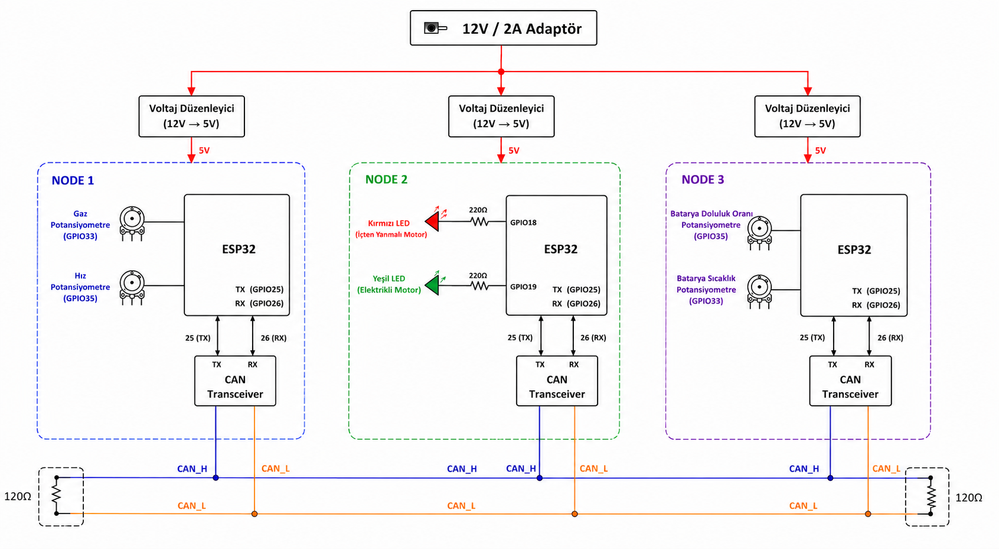

# CAN Bus Based Hybrid Vehicle Powertrain Control System

A 3-node CAN bus network built with ESP32 microcontrollers that simulates the powertrain decisions of a hybrid vehicle. Two nodes read simulated battery and driving data from potentiometers and broadcast it over CAN; a third node listens, decides which motor(s) should run, and shows the result on LEDs.

Developed as the project for the Embedded Systems course at Ankara University, Department of Electrical and Electronics Engineering.

---

## System Architecture



---

## Hardware

- 3x ESP32 (on-chip TWAI/CAN controller)
- 3x SN65HVD230DR CAN transceiver
- 4x 10 kΩ potentiometer
- 1x green LED (electric motor), 1x red LED (combustion engine), 2x 220 Ω resistor
- 2x 120 Ω bus termination resistor
- 12 V / 2 A adapter with a 12 V → 5 V regulator for each node

All nodes share a single CAN bus at **500 kbps** (CAN TX: GPIO25, CAN RX: GPIO26 on every node).

---

## Nodes

Node numbers match the block diagram above.

| Node | Sketch | Function | I/O | CAN ID | Period |
| :--- | :--- | :--- | :--- | :--- | :--- |
| **Node 1 – Driving Dynamics** | `surus_node/` | Reads throttle position and vehicle speed | Throttle pot (GPIO33), speed pot (GPIO35) | Transmits `0x300` | 500 ms |
| **Node 2 – Decision & Display** | `karar_node/` | Listens to `0x200` and `0x300`, runs the decision logic, drives the LEDs | Green LED (GPIO19), red LED (GPIO18) | Receive only | 500 ms loop |
| **Node 3 – Battery Monitor** | `batarya_node/` | Reads battery temperature and state of charge (SOC) | Temperature pot (GPIO33), SOC pot (GPIO35) | Transmits `0x200` | 500 ms |

Potentiometer readings come from the ESP32's 12-bit ADC (0–4095) and are mapped to physical units with `map()`.

### Message format

| CAN ID | Source | `data[0]` | `data[1]` |
| :--- | :--- | :--- | :--- |
| `0x200` | Battery Monitor | Temperature (0–80 °C) | SOC (0–100 %) |
| `0x300` | Driving Dynamics | Throttle (0–100 %) | Speed (0–150 km/h) |

---

## Decision Logic

On every loop the decision node checks the rules from top to bottom; the first rule that matches decides, so the safety rules always win.

| Priority | Condition | Decision |
| :--- | :--- | :--- |
| 1 – Safety | Battery temperature > 60 °C | ICE only |
| 1 – Safety | SOC < 15 % | ICE only |
| 2 – Speed limit | Speed > 120 km/h | ICE only |
| 3 – Efficiency | Speed < 30 km/h and throttle < 40 % | EV only |
| 4 – Default | All other cases | EV + ICE |

The logic is loosely inspired by Toyota's Hybrid Synergy Drive (electric at low speed, engine at high speed, both under acceleration).

### LED output

| State | Green LED (EV) | Red LED (ICE) |
| :--- | :---: | :---: |
| EV only | ON | OFF |
| ICE only | OFF | ON |
| EV + ICE | ON | ON |

---

## Repository Structure

```
├── surus_node/surus_node.ino       # Node 1 – Driving Dynamics
├── karar_node/karar_node.ino       # Node 2 – Decision & Display
├── batarya_node/batarya_node.ino   # Node 3 – Battery Monitor
└── docs/system-block-diagram.png
```

Each sketch sits in a folder with the same name so it opens directly in the Arduino IDE (ESP32 board package required).
